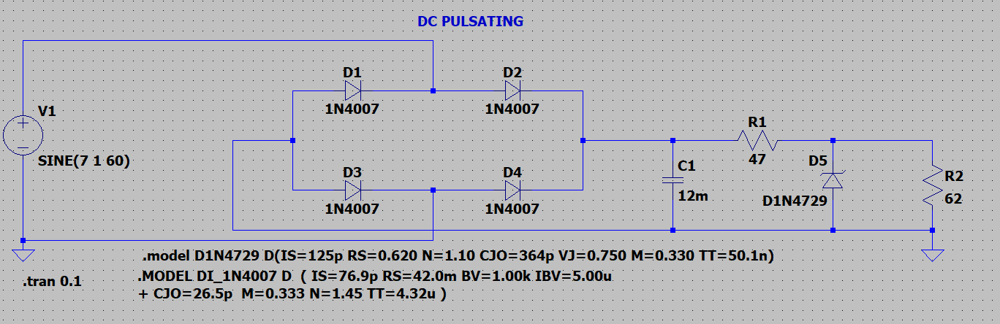
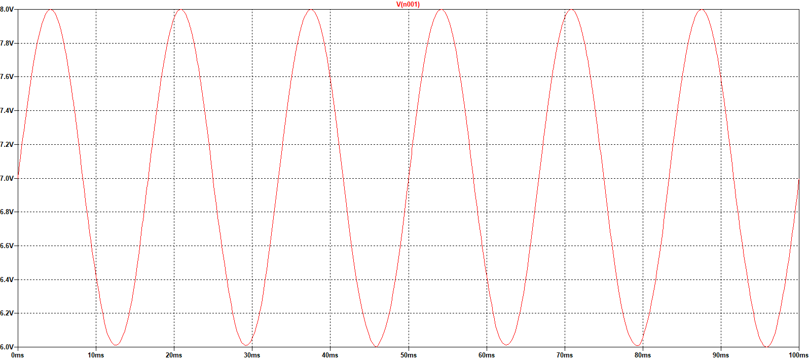
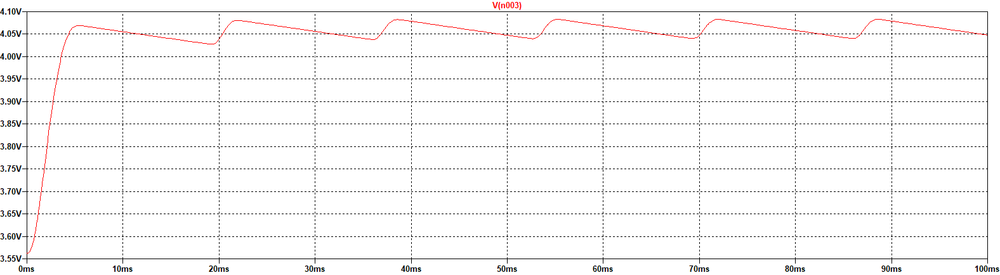
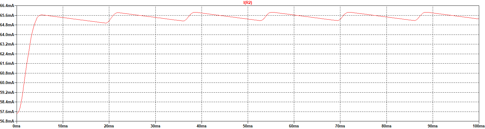

<h1 align="center">Zener Diode Voltage Regulator (4.1 V)</h1>

<p align="center">
  A transformer-less regulator that holds a steady ≈ 4.1 V output from a rectified, pulsating 6–8 V DC input, for load currents from 0 to 70 mA. Uses only E24-series resistors. Designed and simulated in LTspice.
</p>

<p align="center">
  
  
  
  
</p>

<p align="center">
  
</p>

---

## Problem Statement

Design a voltage regulator using a **3.6 V Zener diode** that gives a **constant 4.1 V** output from a **rectified pulsating DC input of 6 V – 8 V**, where the load can draw **0 – 70 mA**. Constraints:

- No transformer
- All resistors from the **E24 series**

## Circuit Operation

| Block | Components | Function |
|---|---|---|
| Input source | V1 = 7 V ± 1 V, 60 Hz | Pulsating DC between 6 V and 8 V |
| Rectifier | D1–D4 (1N4007) bridge | Ensures correct polarity at the regulator |
| Smoothing filter | C1 = 22 mF | Charges on peaks and discharges in troughs to reduce ripple |
| Current limiting | R1 = 47 Ω | Sets the current through the Zener and load branch |
| Regulation | D5 (1N4729, 3.6 V Zener) | Shunt element that clamps the output voltage |
| Load | R2 = 62 Ω | Draws about 65 mA at 4.1 V (near full load) |

### Bill of Materials

| Component | Value | Qty |
|---|---|:---:|
| Resistor (E24) | 47 Ω, 62 Ω | 1 each |
| Capacitor | 22 mF | 1 |
| Rectifier diode | 1N4007 | 4 |
| Zener diode | 1N4729 (3.6 V, 1 W) | 1 |

## Results

| Input voltage | Output voltage | Load current |
|:---:|:---:|:---:|
|  |  |  |

| V<sub>in</sub> | Expected V<sub>out</sub> | Simulated V<sub>out</sub> | Load current |
|:---:|:---:|:---:|:---:|
| 6 V | 4.1 V | 4.059 V | 64.8 mA |
| 7 V | 4.1 V | 4.073 V | 65.1 mA |
| 8 V | 4.1 V | 4.081 V | 65.6 mA |

Across a 2 V change in input, the output varies by only **22 mV** (≈ 0.5 %), with load current inside the required 0–70 mA range.

## Run the Simulation

Open [`simulation/zener_regulator.asc`](simulation/zener_regulator.asc) in [LTspice](https://www.analog.com/en/resources/design-tools-and-calculators/ltspice-simulator.html) and press *Run*. The diode models are included in the schematic as SPICE directives.

## Design Notes and Future Improvements

- The `D1N4729` model in the schematic has no reverse-breakdown parameter (`BV`). For hardware-accurate results, replace it with the manufacturer's 1N4729A model (`BV = 3.6 V`).
- A 3.6 V Zener alone clamps near 3.6 V. To reach 4.1 V, add a forward-biased silicon diode in series with the Zener (V<sub>out</sub> ≈ V<sub>Z</sub> + V<sub>F</sub>), or use a transistor-assisted shunt regulator.
- For better line and load regulation, a Zener-referenced series-pass transistor or an LDO would cut output variation further and improve efficiency.

## Repository Structure

```
zener-voltage-regulator/
├── simulation/
│   └── zener_regulator.asc   # LTspice schematic with diode models
└── docs/
    └── images/
```

## Key Learnings

- How a Zener diode behaves in reverse breakdown and how it is used as a voltage reference
- Choosing the series resistor for minimum Zener current and maximum load current
- Reducing ripple with capacitor filtering
- Line and load regulation analysis using transient simulation

## Author

**Sujith Krishna P G**

<a href="https://github.com/SujithPG-coder"></a>
<a href="https://www.linkedin.com/in/sujithkrishnapg/"></a>

## License

This project is licensed under the [MIT License](LICENSE).
